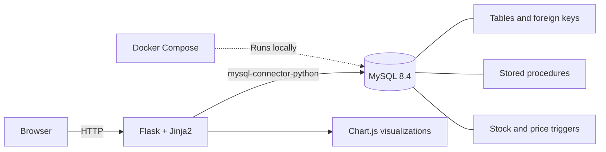
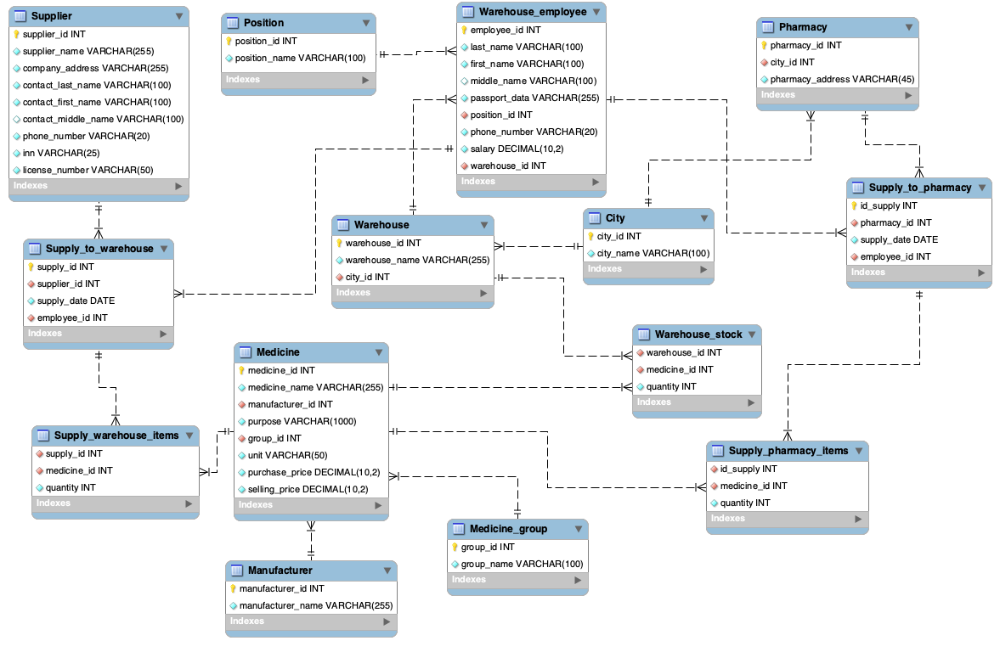

# Pharmacy Warehouse Management System

**English** | [Русский](README.ru.md)

A Flask and MySQL application for exploring pharmacy warehouse data, tracking stock movements, querying supply records, and visualizing inventory-related metrics. The project focuses on **relational database design**, **SQL business logic**, **role-aware web access**, and a **reproducible development environment**.

Built as an educational software project. This is a working local prototype.

**Stack:** Python 3.12 · Flask · MySQL 8.4 · SQL stored procedures & triggers · Jinja2 · Chart.js · Docker Compose · pytest

## What the application does

A pharmacy warehouse sits between suppliers and pharmacies. The database models incoming deliveries, warehouse stock, and outgoing shipments, with supporting records for medicines, manufacturers, therapeutic groups, suppliers, warehouses, pharmacy locations, and employees.

The Flask interface brings these records together in a small, navigable application:

- **Warehouse data:** browse reference tables, incoming deliveries, outgoing shipments, and stock balances.
- **SQL reporting:** run parameterized stored procedures to filter medicines, analyze movements by period, and explore supplier and shipment data.
- **Analytics:** view charts for incoming supply trends, frequently shipped medicines, and the distribution of medicine groups.
- **Application accounts:** log in with a password stored as a `scrypt` hash; use one of three application roles: `db_admin`, `director`, or `warehouse_clerk`.
- **Server-side checks:** limit access to table-view routes according to the user's application role, rather than relying only on hidden navigation links.
- **Reproducible setup:** start MySQL with Docker Compose and initialize a fresh demonstration database from the included SQL scripts.

The project includes **15 database tables**, **4 installed triggers**, and **11 installed procedures** (10 application procedures and 1 additional validation procedure). The demonstration dataset includes **24 medicines** and synthetic warehouse/supply records.

## Interface preview

| Sign in | Administrator dashboard |
| :---: | :---: |
|  |  |

| Warehouse stock | Stored procedure selection |
| :---: | :---: |
|  |  |

| Procedure result | Analytics |
| :---: | :---: |
|  |  |

## Architecture



The Flask backend handles routing, sessions, authorization checks, and database access. MySQL stores the entities and executes business rules using stored procedures and triggers. The browser renders pages with Jinja2 templates and displays analytics with Chart.js.

The database follows a supplier → warehouse → pharmacy flow. Incoming supply items increase stock; outgoing supply items decrease stock and are checked against available quantities. Medicine price validation is also implemented with triggers.



For entity relationships, trigger behavior, SQL design decisions, and implementation limitations, read the [architecture notes](docs/architecture.md).

## Run locally

**Requirements:** Python 3.12 (the tested development version), Git, and Docker with Docker Compose. The setup has been verified on **macOS**; Windows instructions are provided but have not been independently tested.

The commands below assume the repository root as the current directory. The Docker setup binds MySQL to `127.0.0.1:3307`, not to a publicly accessible network interface.

### 1. Clone and configure

**macOS / Linux:**

```bash
git clone https://github.com/Evme22/Pharmacy_Warehouse_Management.git
cd Pharmacy_Warehouse_Management
cp .env.example .env
python3 -m venv .venv
source .venv/bin/activate
python -m pip install -r requirements.txt
```

**Windows PowerShell:**

```powershell
git clone https://github.com/Evme22/Pharmacy_Warehouse_Management.git
cd Pharmacy_Warehouse_Management
Copy-Item .env.example .env
py -3 -m venv .venv
.\.venv\Scripts\python.exe -m pip install -r requirements.txt
```

Edit `.env` and **replace the example values** of `MYSQL_ROOT_PASSWORD`, `DB_PASSWORD`, and `FLASK_SECRET_KEY` before starting Docker. Use distinct, strong secrets. You can generate a Flask key with `python -c "import secrets; print(secrets.token_urlsafe(32))"` (or the virtual-environment Python on Windows).

### 2. Start MySQL and initialize a fresh database

On **macOS / Linux**:

```bash
docker compose -p pharmacy-warehouse-polish -f compose.dev.yaml up -d --wait db
python scripts/init_demo_db.py
```

On **Windows PowerShell** (with Docker Desktop running in Linux-container mode):

```powershell
docker compose -p pharmacy-warehouse-polish -f compose.dev.yaml up -d --wait db
.\.venv\Scripts\python.exe scripts/init_demo_db.py
```

The Python installer loads the schema, synthetic data, application-user table, validated triggers, and procedures. It **refuses to run on a nonempty database** rather than overwrite existing records. A failed installation can still leave a partially initialized database; retry on a new empty database.

There are **no pre-created Flask accounts** in a freshly initialized database.

### 3. Create an application account and start Flask

**macOS / Linux:**

```bash
python app/create_user.py
python app/app.py
```

**Windows PowerShell:**

```powershell
.\.venv\Scripts\python.exe app/create_user.py
.\.venv\Scripts\python.exe app/app.py
```

When prompted, choose a username, one of the roles `db_admin`, `director`, or `warehouse_clerk`, and a password containing at least **12 characters**. Password input is hidden and stored as a hash.

Open **http://127.0.0.1:5000/** and sign in with the account you created.

### 4. Stop the database without deleting its data

```bash
docker compose -p pharmacy-warehouse-polish -f compose.dev.yaml down
```

## Tests

The repository contains automated Flask tests and MySQL integration tests covering authentication, access restrictions, stored procedures, triggers, and database constraints.

Run the application tests:

```bash
python -m pytest tests/ -q
```

To include database integration tests, start and initialize a **disposable test database** first. The integration suite exercises database mutations; do not target important data.

**macOS / Linux:**

```bash
RUN_DB_TESTS=1 python -m pytest tests/ -q
```

**Windows PowerShell:**

```powershell
$env:RUN_DB_TESTS = '1'
.\.venv\Scripts\python.exe -m pytest tests/ -q
Remove-Item Env:RUN_DB_TESTS
```

By default the application reads its connection settings from `.env`. For an isolated database, use a separate Docker Compose project and host port, and set `DB_PORT` to that port for the test process. See the [architecture notes](docs/architecture.md) for the tested SQL behaviors.

## Project layout

```text
app/
  app.py                  Flask routes and views
  db.py                   MySQL connection configuration
  create_user.py          Interactive user creation
  templates/              Jinja2 HTML templates

database/
  Pharmacy_Warehouse.sql  Database schema
  insert_data/            Synthetic demo data
  procedures/             SQL stored procedures
  triggers/               SQL trigger scripts
  queries/                Additional SQL queries
  user-roles/             Application user-table schema
  er-diagram/             ER diagram and MySQL Workbench model

scripts/
  init_demo_db.py         Cross-platform database installer
  init_demo_db.sh         Alternative Bash installer

tests/                    Flask and database tests
compose.dev.yaml          Local MySQL service
.env.example              Configuration template
requirements.txt          Pinned direct Python dependencies
README.md                 English documentation
README.ru.md              Russian documentation
docs/                     Architecture notes
```

## Scope and limitations

This repository demonstrates **database-backed application development**.

- Access to table-view routes is checked by the Flask application; it is **not** a comprehensive MySQL privilege model. Stored-procedure execution is not independently restricted per application role.
- Shipments to pharmacies are **not equivalent to retail sales**. Top-medicine reports summarize shipped quantities, not point-of-sale transactions.
- The minimum shipment-value procedure is a **validation utility**, not an automatically enforced rule for every shipment.
- The prototype does not include a complete production security program, full auditing, stock reconciliation workflows, or historical transaction-price snapshots.
- Database records are synthetic demonstration data; there is no claim of commercial deployment, real operational load, or measured business impact.

## About the project

The main engineering focus was designing a connected SQL schema, moving appropriate rules into the database, exposing queries through Flask, and making the project testable and reproducible by another developer.

Developed by [Evme22](https://github.com/Evme22).
