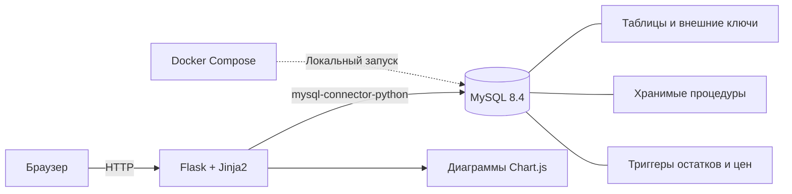
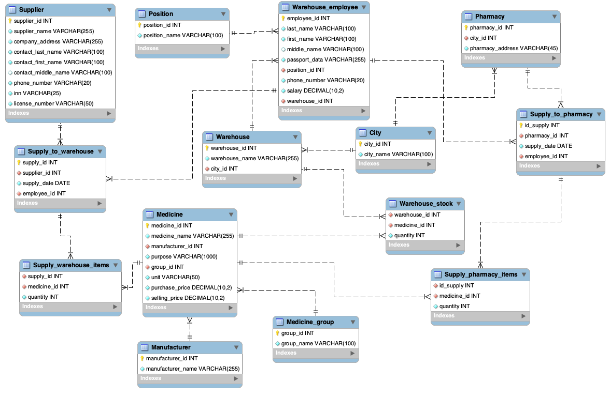

# Pharmacy Warehouse Management System

[English](README.md) | **Русский**

Веб-приложение на Flask и MySQL для просмотра данных аптечного склада, контроля складских остатков, анализа поставок и выполнения SQL-запросов через интерфейс. Основной акцент проекта — **проектирование реляционной базы данных**, **бизнес-логика на SQL**, **разграничение доступа** и **воспроизводимое локальное окружение**.

Это учебная разработка, дополнительно подготовленная как технический проект для портфолио. Приложение можно запустить локально, но оно не является промышленной системой управления фармацевтическим складом.

**Стек:** Python 3.12 · Flask · MySQL 8.4 · хранимые процедуры и триггеры SQL · Jinja2 · Chart.js · Docker Compose · pytest

## Что умеет система

Аптечный склад связывает поставщиков и аптеки. База данных описывает поступление препаратов, хранение на складах и отгрузку в аптеки. Дополнительно учитываются производители, медицинские группы препаратов, поставщики, сотрудники, склады, аптеки и города.

Веб-интерфейс объединяет несколько направлений работы:

- **Складские данные:** просмотр справочников, документов поступлений и отгрузок, складских остатков.
- **SQL-отчёты:** вызов хранимых процедур с параметрами для поиска препаратов, анализа движения за период и изучения поставок.
- **Аналитика:** графики динамики поступлений, препаратов с наибольшими объёмами отгрузок и распределения по медицинским группам.
- **Пользователи:** авторизация с хранением паролей в виде хешей `scrypt`; три роли приложения — `db_admin`, `director` и `warehouse_clerk`.
- **Проверка прав на сервере:** ограничения доступа к страницам таблиц реализованы на стороне Flask, а не только скрытием ссылок в интерфейсе.
- **Воспроизводимый запуск:** MySQL в Docker Compose и автоматическое создание новой демонстрационной базы из SQL-файлов.

В проекте **15 таблиц**, **4 установленных триггера** и **11 хранимых процедур** (10 основных и одна дополнительная процедура проверки). Демонстрационные данные содержат **24 препарата** и синтетические записи о складских операциях.

## Скриншоты интерфейса

| Вход в систему | Главная страница администратора |
| :---: | :---: |
|  |  |

| Складские остатки | Выбор хранимой процедуры |
| :---: | :---: |
|  |  |

| Результат выполнения процедуры | Аналитика |
| :---: | :---: |
|  |  |

## Архитектура



Flask отвечает за маршруты, сессии, проверку прав и обращение к базе данных. MySQL хранит сведения о складах и поставках и выполняет часть бизнес-логики с помощью процедур и триггеров. Jinja2 формирует HTML-страницы, а Chart.js отображает аналитические графики.

Основной процесс: **поставщик → склад → аптека**. Добавление позиции поступления увеличивает складской остаток, добавление позиции отгрузки — уменьшает его с проверкой доступного количества. Триггеры также проверяют корректность цен препаратов.



Подробнее о таблицах, связях, процедурах, триггерах и технических ограничениях — в [описании архитектуры](docs/architecture.ru.md).

## Локальный запуск

**Необходимо:** Python 3.12 (версия, на которой проводилась проверка), Git и Docker с поддержкой Docker Compose. Установка проверена на **macOS**. Инструкция для Windows подготовлена, но отдельно на Windows не тестировалась.

Все команды выполняются из корня репозитория. MySQL будет доступна только локально по адресу `127.0.0.1:3307`.

### 1. Клонирование и подготовка окружения

**macOS / Linux:**

```bash
git clone https://github.com/Evme22/Pharmacy_Warehouse_Management.git
cd Pharmacy_Warehouse_Management
cp .env.example .env
python3 -m venv .venv
source .venv/bin/activate
python -m pip install -r requirements.txt
```

**Windows PowerShell:**

```powershell
git clone https://github.com/Evme22/Pharmacy_Warehouse_Management.git
cd Pharmacy_Warehouse_Management
Copy-Item .env.example .env
py -3 -m venv .venv
.\.venv\Scripts\python.exe -m pip install -r requirements.txt
```

Откройте `.env` и **замените демонстрационные значения** `MYSQL_ROOT_PASSWORD`, `DB_PASSWORD` и `FLASK_SECRET_KEY` на собственные надёжные секреты. Для Flask можно сгенерировать ключ командой `python -c "import secrets; print(secrets.token_urlsafe(32))"` (на Windows — соответствующим Python из виртуального окружения).

Файл `.env` не следует публиковать. В Git добавляется только `.env.example`.

### 2. Запуск MySQL и создание чистой базы

**macOS / Linux:**

```bash
docker compose -p pharmacy-warehouse-polish -f compose.dev.yaml up -d --wait db
python scripts/init_demo_db.py
```

**Windows PowerShell** (Docker Desktop должен быть запущен в режиме Linux-контейнеров):

```powershell
docker compose -p pharmacy-warehouse-polish -f compose.dev.yaml up -d --wait db
.\.venv\Scripts\python.exe scripts/init_demo_db.py
```

Python-установщик создаёт таблицы, загружает синтетические данные, настраивает таблицу пользователей, триггеры и процедуры. Он **отказывается запускаться повторно, если база не пустая**, чтобы не перезаписывать имеющиеся записи. При ошибке во время установки база может остаться частично заполненной — повторять установку следует на новой пустой базе.

После установки **готовых учётных записей для входа во Flask нет**.

### 3. Создание пользователя и запуск приложения

**macOS / Linux:**

```bash
python app/create_user.py
python app/app.py
```

**Windows PowerShell:**

```powershell
.\.venv\Scripts\python.exe app/create_user.py
.\.venv\Scripts\python.exe app/app.py
```

Укажите логин, роль (`db_admin`, `director` или `warehouse_clerk`) и пароль длиной не менее **12 символов**. Пароль вводится без отображения на экране и сохраняется в виде хеша.

Откройте **http://127.0.0.1:5000/** и войдите с созданной учётной записью.

### 4. Остановка MySQL без потери данных

```bash
docker compose -p pharmacy-warehouse-polish -f compose.dev.yaml down
```

Именованный том MySQL сохранится. **Не добавляйте `--volumes`**, если не хотите удалить данные этого окружения. Изменение паролей в `.env` не изменяет автоматически учётные данные MySQL в уже созданном томе.

## Автоматизированные тесты

В репозитории есть тесты Flask и интеграционные тесты MySQL, проверяющие авторизацию, доступ, процедуры, триггеры и ограничения базы данных.

Обычный запуск тестов:

```bash
python -m pytest tests/ -q
```

Для включения интеграционных тестов предварительно запустите и инициализируйте **отдельную тестовую базу**. Набор интеграционных тестов проверяет операции изменения данных, поэтому его не следует запускать на ценной базе.

**macOS / Linux:**

```bash
RUN_DB_TESTS=1 python -m pytest tests/ -q
```

**Windows PowerShell:**

```powershell
$env:RUN_DB_TESTS = '1'
.\.venv\Scripts\python.exe -m pytest tests/ -q
Remove-Item Env:RUN_DB_TESTS
```

Настройки подключения берутся из `.env`. Для тестирования отдельного Docker-окружения можно использовать другой Compose-проект и порт, передав соответствующее значение `DB_PORT` процессу тестов. Детали проверяемой SQL-логики — в [описании архитектуры](docs/architecture.ru.md).

## Структура проекта

```text
app/
  app.py                  Flask-маршруты и представления
  db.py                   Настройки подключения к MySQL
  create_user.py          Создание пользователей
  templates/              HTML-шаблоны Jinja2

database/
  Pharmacy_Warehouse.sql  Схема базы данных
  insert_data/            Синтетические демонстрационные данные
  procedures/             Хранимые процедуры SQL
  triggers/               SQL-триггеры
  queries/                Дополнительные SQL-запросы
  user-roles/             SQL-схема таблицы пользователей
  er-diagram/             ER-диаграмма и модель MySQL Workbench

scripts/
  init_demo_db.py         Кроссплатформенный установщик
  init_demo_db.sh         Дополнительный Bash-установщик

tests/                    Тесты Flask и MySQL
compose.dev.yaml          Локальный сервис MySQL
.env.example              Пример конфигурации
requirements.txt          Зафиксированные прямые зависимости
README.md                 Документация на английском
README.ru.md              Документация на русском
docs/                     Описание архитектуры
```

## Границы реализации

Это **учебный технический прототип**, а не сертифицированная складская система для действующих аптек.

- Права на просмотр таблиц проверяет Flask. Это **не полноценная модель SQL-привилегий**. Вызов хранимых процедур не ограничен отдельно для каждой роли приложения.
- Отгрузки в аптеки **не равны розничным продажам**. Отчёты по популярным препаратам отражают количество отгруженных единиц, а не продажи на кассе.
- Процедура минимальной суммы поставки — **вспомогательная проверка**, а не автоматическое ограничение для каждой отгрузки.
- Не реализованы полноценный аудит действий, промышленная защита приложения, процедуры инвентаризации и исторические снимки цен операций.
- Используются синтетические данные; нет заявлений о реальном коммерческом внедрении, производственной нагрузке и подтверждённом экономическом эффекте.

## О проекте

Главная инженерная задача — спроектировать связанную SQL-модель, реализовать необходимые правила на уровне базы данных, предоставить доступ к отчётам через Flask и сделать проект воспроизводимым для другого разработчика.

Исходный код опубликован для технического ознакомления. **Открытая лицензия не предоставлена**: публичность репозитория сама по себе не означает разрешения на использование или распространение кода.

Автор: [Evme22](https://github.com/Evme22).
