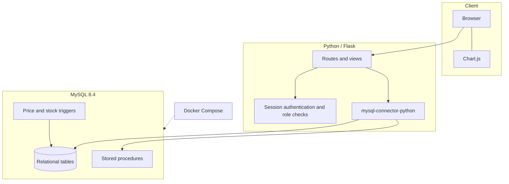
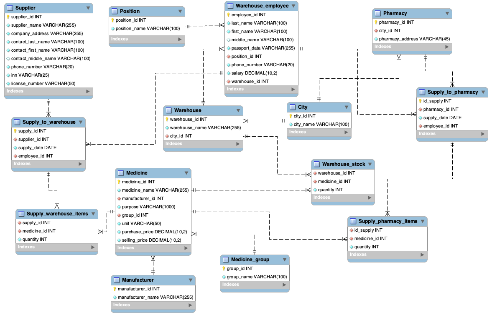
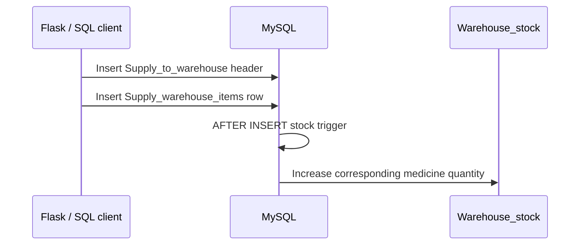

# Architecture and SQL design

**English** | [Русский](architecture.ru.md) · [← Back to README](../README.md)

This document describes the **runnable local prototype** in this repository. It focuses on how Flask interacts with MySQL, how the warehouse data is modeled, and which rules are enforced by the application versus the database.

## 1. Components and responsibilities



| Layer | Implementation | Responsibility |
| --- | --- | --- |
| Web | `app/app.py`, Jinja2 templates | Routes, HTML rendering, form processing, session checks, table views, charts |
| Database adapter | `app/db.py` | Connect to MySQL using values from `.env` |
| Account provisioning | `app/create_user.py` | Interactively create accounts with `scrypt` password hashes |
| Persistence | `database/Pharmacy_Warehouse.sql` and SQL scripts | Relational tables, foreign keys, triggers, stored procedures |
| Runtime | `compose.dev.yaml` | Local MySQL 8.4 with health check and persistent volume |
| Initialization | `scripts/init_demo_db.py` | Apply schema and synthetic data to a **fresh, empty** database |
| Verification | `tests/` | Flask tests and optional MySQL integration tests |

The application connects directly to MySQL. It is a monolithic web application with database-side logic, **not** a microservices architecture or an HTTP API used by a separate SPA.

## 2. Data model

The schema contains **14 warehouse-domain tables** plus the application `users` table, which is created by a separate SQL script.

| Area | Tables | Purpose |
| --- | --- | --- |
| Locations | `City`, `Warehouse`, `Pharmacy` | Warehouse and pharmacy locations |
| Staff | `Position`, `Warehouse_employee` | Employee roles and warehouse assignment |
| Catalog | `Medicine`, `Medicine_group`, `Manufacturer` | Medicine attributes and classification |
| Suppliers | `Supplier` | Supplier records |
| Incoming supply | `Supply_to_warehouse`, `Supply_warehouse_items` | Supplier shipment headers and line items |
| Outgoing supply | `Supply_to_pharmacy`, `Supply_pharmacy_items` | Pharmacy shipment headers and line items |
| Inventory | `Warehouse_stock` | Quantity per warehouse and medicine |
| Authentication | `users` | Application username, password hash and role |

`Warehouse_stock` uses a composite key of `(warehouse_id, medicine_id)`. Supply headers describe the counterpart, date, and responsible employee; line-item tables describe medicines and quantities. Foreign keys connect the entities and reject invalid references.



The bundled [MySQL Workbench model](../database/er-diagram/БД%20склада.mwb) provides the editable diagram source.

## 3. Warehouse movements

### Incoming deliveries



A stock trigger determines the warehouse from the employee associated with the incoming supply. It increases an existing stock balance or inserts a new `(warehouse_id, medicine_id)` balance.

### Outgoing shipments

When a `Supply_pharmacy_items` row is inserted, a trigger finds the warehouse through the shipment's responsible employee. It checks that the medicine is present and that enough units are available, then decreases the stock balance. An insufficient balance causes the statement to fail instead of silently making stock negative.

**Important modeling boundary:** the current system infers the originating warehouse from the employee's assigned warehouse. It does not implement a separate shipment-location field or a comprehensive inventory reservation workflow.

### Medicine prices

Two price-related triggers validate medicine prices on insertion and update. Negative or zero purchase/selling prices are rejected. The installed stock and price rules total **four triggers**, sourced from the validated trigger scripts used by the installer.

## 4. SQL reporting and validation

MySQL stores **11 procedures**: ten used for application queries/reports and one separate shipment-value validation utility.

Representative reports include:

| Procedure | What it reports |
| --- | --- |
| `Get_Medicines_By_Group` | Medicines in a selected therapeutic group |
| `Get_Medicines_By_Price_Range` | Medicines within a given price interval |
| `Get_Supplied_Medicines_By_Pharmacy` | Medicines shipped to a selected pharmacy |
| `Get_Medicine_Movement_By_Period` | Incoming and outgoing medicine movements during a period |
| `Get_Top10_Medicines_By_Pharmacy_Supply` | Most frequently shipped medicines, ranked by outgoing quantity |
| `Get_Low_Supply_Medicines_By_Period` | Medicines with comparatively low shipment volume within a period |
| `Validate_Pharmacy_Supply_Min_Value` | Separate validation for a minimum shipment value |

The top-ten query is based on **pharmacy shipments, not consumer purchases**. Its recorded price values come from the current medicine catalog, not a transaction-time price snapshot. The minimum-value procedure does **not** automatically enforce a shipment-level minimum on every write.

Flask exposes procedure selection and parameter forms through `/procedures`. Graphs on `/analytics` combine ordinary SQL aggregation and stored-procedure output.

## 5. Authentication and authorization

- `app/create_user.py` creates a database-backed application account. Passwords are hashed with Werkzeug `scrypt`; a 12-character minimum is checked when creating a user.
- Flask uses session-based authentication. Authorization checks are made on the server for access to table-view routes.
- The recognized roles are `db_admin`, `director`, and `warehouse_clerk`.
- **Role access is not an end-to-end SQL permission system.** The Flask application uses one MySQL service account. The procedure interface is not independently restricted per application role, and this implementation must not be treated as a hardened production authorization layer.

There is no default application login after database initialization. Accounts are provisioned separately.

## 6. Local initialization

The recommended setup is a Python installer backed by Docker Compose:

```bash
docker compose -p pharmacy-warehouse-polish -f compose.dev.yaml up -d --wait db
python scripts/init_demo_db.py
python app/create_user.py
python app/app.py
```

The installer checks for existing tables, routines, triggers, and events before proceeding. It installs the schema and synthetic seed data **before** attaching stock triggers, avoiding a second application of historical supply changes. It then installs the application-users table, validated triggers, and procedures. The SQL files are executed inside the Docker MySQL container over standard input.

The installer is **not a migration system**: it stops when the database is not empty. MySQL DDL may persist even if a later step fails, so setup is not fully atomic. Use a new empty database to retry.

The default host-side MySQL port is `3307`. A separate Compose project and port can be passed when deliberately creating an isolated test instance:

```bash
MYSQL_HOST_PORT=3309 docker compose -p pharmacy-warehouse-python-test -f compose.dev.yaml up -d --wait db
python scripts/init_demo_db.py --project pharmacy-warehouse-python-test --port 3309
```

These example commands are for **macOS/Linux shells**. Windows PowerShell needs `$env:MYSQL_HOST_PORT = '3309'` instead of the prefix assignment. The Python installer was verified on macOS; portability to Windows is intended but not independently verified.

## 7. Testing strategy

Flask tests cover sign-in, session behavior, and role-sensitive views. MySQL integration tests exercise constraints, trigger-driven changes, and stored procedure results using controlled sample operations. Some tests intentionally perform SQL writes and roll them back.

```bash
python -m pytest tests/ -q
RUN_DB_TESTS=1 python -m pytest tests/ -q
```

`RUN_DB_TESTS=1` enables optional database-dependent tests. For reliable isolation, use a disposable database or separate Compose project and pass its port through `DB_PORT`; never target a database containing valuable records.

The project previously passed a full 45-test run during local development. That is a **local test result**, not a continuously maintained CI badge or a claim of cross-platform verification.

## 8. Intentional scope

Known boundaries include limited authorization granularity, no complete audit trail, no stock reservations or comprehensive reconciliation, no historical shipment-price snapshots, no full operational order lifecycle, and no production deployment/security guarantees. The demo contains synthetic records and no verified business performance metrics.
