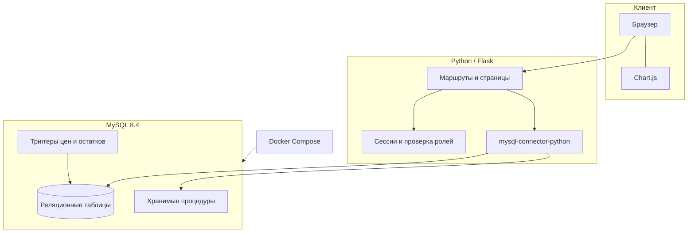
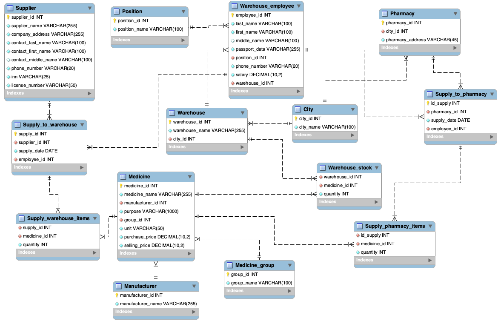
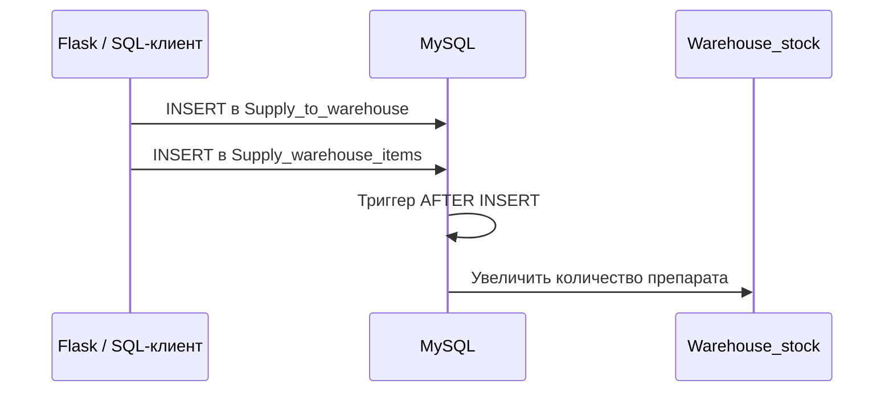

# Архитектура и SQL-модель

[English](architecture.md) | **Русский** · [← К README](../README.ru.md)

Документ описывает **работающий локальный прототип** из этого репозитория: взаимодействие Flask и MySQL, структуру складских данных и распределение бизнес-правил между приложением и базой данных.

## 1. Компоненты системы



| Компонент | Реализация | Назначение |
| --- | --- | --- |
| Веб-приложение | `app/app.py`, шаблоны Jinja2 | Маршруты, страницы, формы, сессии, доступ к таблицам, графики |
| Подключение к БД | `app/db.py` | Подключение к MySQL через переменные `.env` |
| Создание аккаунтов | `app/create_user.py` | Интерактивное создание пользователей с хешированием `scrypt` |
| База данных | `database/Pharmacy_Warehouse.sql` и SQL-скрипты | Таблицы, внешние ключи, триггеры, процедуры |
| Окружение | `compose.dev.yaml` | MySQL 8.4 с проверкой готовности и постоянным томом данных |
| Инициализация | `scripts/init_demo_db.py` | Заполнение **новой пустой** базы синтетическими данными |
| Тестирование | `tests/` | Тесты Flask и дополнительные интеграционные тесты MySQL |

Flask напрямую обращается к MySQL. Это монолитное веб-приложение с логикой на стороне базы данных, **а не** микросервисная система или отдельный REST API для SPA.

## 2. Модель данных

В базе **14 предметных таблиц** аптечного склада и дополнительная таблица `users`, которая создаётся отдельным SQL-скриптом.

| Область | Таблицы | Назначение |
| --- | --- | --- |
| Расположение | `City`, `Warehouse`, `Pharmacy` | Города, склады и аптеки |
| Персонал | `Position`, `Warehouse_employee` | Должности, сотрудники и принадлежность складу |
| Каталог | `Medicine`, `Medicine_group`, `Manufacturer` | Препараты, медицинские группы, производители |
| Поставщики | `Supplier` | Информация о поставщиках |
| Поступления | `Supply_to_warehouse`, `Supply_warehouse_items` | Заголовки поступлений и их позиции |
| Отгрузки | `Supply_to_pharmacy`, `Supply_pharmacy_items` | Заголовки отгрузок и их позиции |
| Остатки | `Warehouse_stock` | Количество препарата на каждом складе |
| Авторизация | `users` | Логин, хеш пароля и роль приложения |

В `Warehouse_stock` используется составной ключ `(warehouse_id, medicine_id)`. Заголовок поставки хранит дату, контрагента и ответственного сотрудника; позиции содержат препараты и количества. Внешние ключи связывают сущности и не позволяют создавать записи с несуществующими ссылками.



Редактируемая исходная модель находится в [файле MySQL Workbench](../database/er-diagram/БД%20склада.mwb).

## 3. Движение препаратов

### Поступление на склад



При добавлении позиции поступления триггер определяет склад через ответственного сотрудника. Если препарат уже присутствует на этом складе, остаток увеличивается. В противном случае создаётся новая строка для пары «склад — препарат».

### Отгрузка в аптеку

При добавлении позиции `Supply_pharmacy_items` триггер определяет склад через сотрудника, ответственного за отгрузку. Затем проверяет наличие препарата и достаточность остатка. Если товара недостаточно, SQL-операция завершается ошибкой; отрицательный остаток не создаётся.

**Ограничение модели:** исходный склад определяется через закреплённый за сотрудником склад. Отдельного поля склада отправления и полноценного механизма резервирования запасов нет.

### Проверка цен

Два триггера проверяют значения закупочной и отпускной цены при добавлении и изменении препарата. Нулевые и отрицательные цены не допускаются. Всего установщик создаёт **четыре триггера** для складских остатков и цен.

## 4. Хранимые процедуры и отчёты

В MySQL устанавливаются **11 процедур**: десять для запросов и отчётов приложения и одна отдельная процедура проверки стоимости отгрузки.

Примеры:

| Процедура | Результат |
| --- | --- |
| `Get_Medicines_By_Group` | Препараты выбранной медицинской группы |
| `Get_Medicines_By_Price_Range` | Препараты в заданном диапазоне цен |
| `Get_Supplied_Medicines_By_Pharmacy` | Препараты, отгруженные конкретной аптеке |
| `Get_Medicine_Movement_By_Period` | Поступления и отгрузки за период |
| `Get_Top10_Medicines_By_Pharmacy_Supply` | Десять препаратов с наибольшими объёмами отгрузок |
| `Get_Low_Supply_Medicines_By_Period` | Препараты с относительно низким объёмом отгрузок за период |
| `Validate_Pharmacy_Supply_Min_Value` | Отдельная проверка минимальной стоимости отгрузки |

Рейтинг популярных препаратов основан на **отгрузках в аптеки, а не на продажах конечным покупателям**. Используемые цены берутся из текущего справочника, а не из снимка цены на дату операции. Проверка минимальной суммы **не является автоматическим ограничением** для каждой записи отгрузки.

Маршрут Flask `/procedures` позволяет выбирать процедуры, вводить параметры и получать результаты. На странице `/analytics` используются SQL-агрегации и результаты хранимых процедур.

## 5. Авторизация и права доступа

- `app/create_user.py` создаёт учётные записи приложения. Пароли хешируются средствами Werkzeug методом `scrypt`; при создании действует минимальная длина 12 символов.
- Flask использует сессии. Проверка прав доступа к страницам таблиц выполняется на сервере.
- Допустимые роли: `db_admin`, `director`, `warehouse_clerk`.
- **Роли Flask не равны полноценной модели SQL-привилегий.** Для обращения к MySQL используется один сервисный пользователь. Вызов процедур отдельно не ограничивается для каждой роли приложения; систему нельзя считать промышленно защищённой.

После установки демонстрационной базы готовых учётных записей для входа нет — первого пользователя нужно создать вручную.

## 6. Инициализация локального окружения

Основной вариант запуска — Python-установщик и Docker Compose:

```bash
docker compose -p pharmacy-warehouse-polish -f compose.dev.yaml up -d --wait db
python scripts/init_demo_db.py
python app/create_user.py
python app/app.py
```

До начала установки проверяется отсутствие таблиц, процедур, триггеров и событий в базе. Установщик загружает схему и синтетические данные **до подключения триггеров**, чтобы демонстрационные исторические поступления не увеличили остатки повторно. Затем создаются таблица пользователей, необходимые триггеры и процедуры. SQL-файлы передаются непосредственно в MySQL-контейнер Docker через стандартный ввод.

Установщик **не является системой миграций**: повторный запуск на заполненной базе блокируется. Операции DDL в MySQL не гарантируют полного отката при ошибке посередине установки. В такой ситуации нужно использовать новую пустую базу.

Основной порт на компьютере — `3307`. Для независимого тестового окружения можно выбрать другой проект Docker Compose и порт:

```bash
MYSQL_HOST_PORT=3309 docker compose -p pharmacy-warehouse-python-test -f compose.dev.yaml up -d --wait db
python scripts/init_demo_db.py --project pharmacy-warehouse-python-test --port 3309
```

Эти команды приведены для оболочек **macOS/Linux**. В Windows PowerShell значение порта задаётся через `$env:MYSQL_HOST_PORT = '3309'`. Python-установщик проверен на macOS; на Windows запуск пока отдельно не проверялся.

## 7. Подход к тестированию

Тесты Flask проверяют авторизацию, работу сессий и ограничения доступа. Интеграционные тесты MySQL проверяют ограничения ссылочной целостности, результаты процедур и изменение остатков через триггеры. Часть тестов намеренно выполняет SQL-записи и откатывает их.

```bash
python -m pytest tests/ -q
RUN_DB_TESTS=1 python -m pytest tests/ -q
```

Переменная `RUN_DB_TESTS=1` включает проверки, требующие работающей базы. Для надёжной изоляции следует использовать временную тестовую базу или отдельный Docker Compose-проект с собственным портом `DB_PORT`. Не запускайте интеграционные тесты на ценных данных.

Во время локальной разработки ранее был успешно выполнен полный набор из **45 тестов**. Это зафиксированный результат локальной проверки, **не** постоянно обновляемый показатель CI и не подтверждение работы на всех ОС.

## 8. Границы проекта

Проект предназначен для демонстрации навыков разработки на Flask и MySQL. Он не рассчитан на реальную фармацевтическую эксплуатацию без серьёзного расширения и проверки.

Среди ограничений — неполное разграничение операций по ролям, отсутствие полноценного журнала действий, резервирования и сверки запасов, снимков исторических цен, полного жизненного цикла заказов и промышленной конфигурации безопасности. Демонстрационные данные синтетические; подтверждённых коммерческих показателей и результатов реального внедрения нет.
